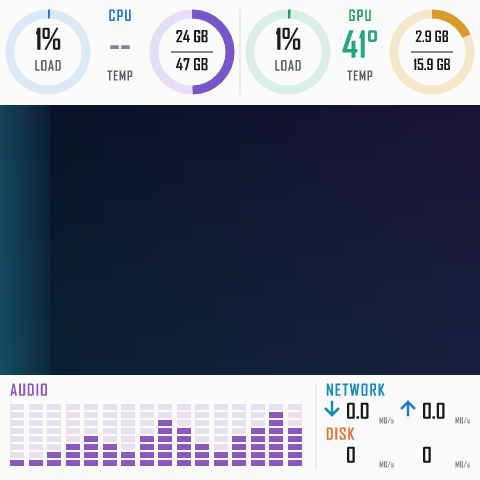

# LoopPanel

[简体中文](README.md) | **English** | [한국어](README.ko.md)


LoopPanel is a lightweight native USB display program for Windows. It combines a local image, GIF, or built-in animation with an editable MiniJinja + SVG template, collects local hardware information and audio spectrum data, and sends the complete frame directly to a supported display.

The current version has been verified with only one device configuration: the 480×480 MacroSilicon MS9132 display shared by the JONSBO TM-360 and TM-280. The two products differ only in radiator size, and both have been verified on real hardware. The project name is generic, but the transport layer is currently not a universal driver for all JONSBO displays. See [Compatibility](#compatibility) and the [device porting guide](docs/DEVICE_PORTING.md).



LoopPanel is an independent community project and is not affiliated with, or officially authorized by, JONSBO, MacroSilicon, PawnIO, NVIDIA, or AMD.

## Project Origin

This project started from the need to replace the resident official software for the JONSBO TM-360. During development, the following were done on real hardware: USB descriptor verification, comparison against public captures, frame format verification, color and orientation tests, keep-alive experiments, resource measurements, and long-running dynamic display tests.

The display protocol is based mainly on the B360GT Windows USBPcap hardware capture from [Fakinvisibility/b360gt-driver](https://github.com/Fakinvisibility/b360gt-driver/tree/94ae7f2a710123b582ca3fa806d85ee1c684e287). The startup timing, UYVY422 encoding, and frame chunking have been verified on a local TM-360. Later hardware fixes for the DS339 were also used to rule out the earlier incorrect BGR888 conclusion: the [UYVY fix](https://github.com/emaspa/InfoPanel-linux/commit/21fe373f8de962491169d0d611fb297321df60ec) and the [initialization timing fix](https://github.com/emaspa/InfoPanel-linux/commit/94415ac46260cf5f1b0d4e670b9a48e4ad38105b).

The repository is licensed under the MIT License. For the licenses of third-party components and the PawnIO IntelMSR and AMDFamily17 modules, see [THIRD-PARTY-NOTICES.md](THIRD-PARTY-NOTICES.md) and [THIRD-PARTY-LICENSES.txt](THIRD-PARTY-LICENSES.txt).

## Features

- Double-click a single `LoopPanel.exe` to start the display and the native Win32 tray icon;
- If the CPU temperature service is missing on first run, a UAC prompt appears once; after a successful install, later launches do not elevate;
- From the tray: enable start at login, open the configuration, view status, and exit safely;
- Three original 16:9 sample backgrounds, PNG, JPEG, GIF, and a built-in animation when no asset is provided;
- A 480×270 16:9 central image area, and a freely editable 480×480 SVG dashboard layer;
- CPU, RAM, NVIDIA or AMD Radeon GPU, video memory, network, and disk information;
- WASAPI loopback capture, 1024-point FFT, and a 16-band real-time audio spectrum;
- A tray menu to switch the display layout (the default dashboard, or four built-in large-text layouts: Simple, CPU + GPU, Temperatures and Clock) and the temperature unit (Celsius / Fahrenheit), and to rotate through the layouts automatically at a chosen interval;
- Tray text and messages that follow the Windows display language: Simplified Chinese, English, Korean;
- A single-instance display lock and a check for conflicts with the official software.

The program contains no browser engine, web service, account, telemetry, auto-update, or ARGB control code.

## Compatibility

The only supported and hardware-verified device configuration is:

| Item | Current configuration |
|---|---|
| Tested product | JONSBO TM-360; TM-280 (same display module, only the radiator size differs; verified on a Ryzen 7 7800X3D + Radeon RX 9070 XT system) |
| USB VID/PID | `345F:9132` |
| Controller family | MacroSilicon MS9132 |
| Resolution | 480×480 |
| Display mode | VIC 143, UYVY422 |
| Control interface | HID interface 0, 9-byte Feature Report buffer |
| Video interface | vendor interface 3, bulk OUT endpoint `0x04` |
| Frame size | 460,816 bytes |
| Chunking | `7 × 65,536 + 2,064`, no ZLP after the frame |
| Windows driver | `HidUsb` + `libusb0`, usually shown as `MS USB Display` |

Sensor collection is independent of the display transport layer and is selected automatically based on the local hardware:

| Hardware | Data source | Notes |
|---|---|---|
| Intel CPU | PawnIO `IntelMSR` | Package temperature |
| AMD CPU, Family 17h–1Ah (Zen to Zen 5) | PawnIO `AMDFamily17` | SMN-reported temperature Tctl; a few Zen/Zen+ models are converted to Tdie using the Linux k10temp offset table |
| NVIDIA GPU | NVML bundled with the driver | Preferred |
| AMD Radeon GPU | ADL bundled with the driver (`atiadlxx.dll`) | Used when NVML is unavailable; requires driver support for `ADL2_New_QueryPMLogData_Get`; when multiple AMD adapters are present, the one with the most dedicated video memory is used |
| Other GPUs (for example Intel Arc or integrated graphics) | Windows PDH counters + D3DKMT | Used when neither NVML nor ADL is available; provides load, video memory and temperature (temperature depends on whether the driver reports it), with no power, fan or clock data; readings were checked on a Radeon but it has not been run on Intel graphics |

Other CPUs (including earlier AMD families) have no temperature support, and the temperature service installation self-check fails with a clear error.

Having the same brand, controller, or `345F:9132` VID/PID alone is not enough to determine compatibility. Within the same controller family, different resolutions, frame header high bits, ZLP, trigger, and initialization strategies have been found. The current code does not mislabel other JONSBO liquid coolers with displays, or other MS9132 OEM displays, as supported devices.

## Usage

### Prerequisites

1. Windows 10/11 x64;
2. The original signed `MS USB Display` / `libusb0` driver of the TM-360;
3. PawnIO 2.x installed; its driver and `PawnIOLib.dll` are not distributed with this project;
4. The vendor software currently driving this display fully exited: `JONSBO-AIO.exe` or `LcdFusion.exe` (LCD Fusion).

### Launch

Keep the files in the release directory in their relative positions, then double-click:

```text
LoopPanel.exe
```

No arguments, command line, or launch script is needed.

On first launch, if the LoopPanel CPU temperature service is not yet present on the system, the main program requests UAC once. The elevated internal service program checks PawnIO, installs and starts the minimal temperature service, and then returns control to the normal-privilege LoopPanel main program. After a successful install, neither manual launches nor start at login show a UAC prompt again.

If the user cancels UAC, or the temperature service installation or self-check fails, LoopPanel shows an error and stops this launch. It does not continue writing to the display without the default temperature feature.

While running, right-click the tray icon to:

- view the display and CPU temperature status;
- open `looppanel.toml`, and apply edits immediately with "Reload settings";
- switch the layout under "Display", and between Celsius and Fahrenheit under "Unit"; the choice applies immediately and is remembered. Besides the default dashboard there are four large-text layouts: Simple (CPU temperature + load), CPU + GPU (temperature + load of each), Temperatures (CPU and GPU temperature) and Clock (the time, with CPU / GPU temperature below);
- tick "Rotate automatically" to cycle through all layouts in menu order; "Rotation interval" offers 10 s / 30 s (default) / 1 min / 5 min. Picking a layout under "Display" while rotating jumps to it and the rotation continues from there;
- turn the full-screen background image / GIF of the large-text layouts on or off with "Background in large-text layouts" (the background is dimmed, and the digits have an outline and a shadow);
- enable or disable "start at login";
- retry after a connection failure;
- exit and release the USB interface.

## Configuration

The program always reads `looppanel.toml` next to `LoopPanel.exe`. Relative background, template, and font paths are resolved against the directory of this configuration file.

```toml
background = "samples/aurora-circuit.jpg"
template = "dashboard.svg.jinja"
font = 'C:\Windows\Fonts\bahnschrift.ttf'
title = "LoopPanel"
custom_lines = []

fps = 5
sensor_interval_ms = 1000
brightness = 0.90
show_clock = false
show_sensors = true
```

- `background`: PNG, JPEG, or GIF; the bundled `aurora-circuit.jpg` is used by default, and you can also switch directly to `liquid-alloy.jpg` or `orbital-glass.jpg`; if omitted, the built-in animation is used;
- `template`: the MiniJinja SVG template;
- `font`: only this one local TTF/TTC font is loaded;
- `fps`: 1–30, the frame rate upper limit for the built-in animation and GIFs;
- `sensor_interval_ms`: minimum 250 ms; the default template updates hardware data at 1 Hz;
- `brightness`: 0.05–1.0;
- `show_clock`, `show_sensors`: for the template to check; they also control the corresponding sampling and refresh.

The background is fitted into the central 480×270 area with its aspect ratio preserved; the default template draws information in the areas above and below. GIFs are limited to 120 frames and are decoded at startup to limit resident memory. Official JONSBO assets are not included in this repository.

After changing the configuration or template, choose "Reload settings" from the tray menu to apply it without exiting; if the new content has an error, the reason is shown and the current display is kept.

The comments that ship in the configuration file are rewritten at startup in the Windows display language (Simplified Chinese, Korean, or English for everything else); comments you add yourself and all settings are left untouched.

## Template Syntax

A template must produce a valid 480×480 SVG. LoopPanel uses strict undefined-variable checking and XML auto-escaping; a misspelled field causes an error instead of silently producing empty output.

```xml
<svg xmlns="http://www.w3.org/2000/svg" width="480" height="480" viewBox="0 0 480 480">
  
  <text x="20" y="30">{{ "%.0f"|format(cpu.load_percent) }}%</text>
  
  
  <text x="20" y="60">{{ "%d"|format(gpu.temperature_c) }}°C</text>
  
  <g id="audio-spectrum"/>
</svg>
```

Templates can use conditionals, loops, and formatting filters. Missing hardware values are `none`. For the exact context structure, fields, examples, and audio spectrum marker rules, see the [template guide](docs/TEMPLATES.md). The default template is only an editable example, not a fixed layout of the program.

## Tech Stack

- Rust 2024 edition; tested toolchain Rust 1.97.1;
- `x86_64-pc-windows-gnullvm`, `rust-lld`, `+crt-static`, Thin LTO;
- Win32, SetupAPI, HID Feature Report, and `libusb0` bulk OUT;
- MiniJinja 2.21 + resvg/usvg/tiny-skia;
- `image` for decoding PNG, JPEG, and GIF;
- PDH Processor Utility, Windows CPU Set, NT per-core busy times, PowrProf, GlobalMemoryStatusEx;
- NVML bundled with the NVIDIA driver, or ADL bundled with the AMD driver;
- IP Helper API, PDH;
- WASAPI loopback + a self-contained radix-2 FFT;
- PawnIO 2.x + the official IntelMSR module (Intel Package temperature) or AMDFamily17 module (AMD Tctl/Tdie temperature).

For the detailed data flow and module responsibilities, see the [architecture overview](docs/ARCHITECTURE.md).

## Build

The default project target is set to `x86_64-pc-windows-gnullvm` in `.cargo/config.toml`:

```powershell
cargo fmt --all -- --check
cargo test --all-targets --locked
cargo clippy --all-targets --locked -- -D warnings
cargo build --release --bins --locked
```

Only two programs are produced:

- `looppanel.exe`: the GUI main program without a console window, named `LoopPanel.exe` when released;
- `looppanel-temperature-service.exe`: the service program that the main program calls internally on first launch; it is not a user entry point.

The build directory also gets `dashboard.svg.jinja`, which must stay in the same directory as `LoopPanel.exe` unless `looppanel.toml` specifies another template path.

The vector source of the icon is `assets/looppanel-icon.svg`; the transparent PNG and multi-size ICO in the same directory are derived release assets. The main program embeds the ICO directly as the tray icon.

## Safety Boundaries

- Double-clicking the main program may access a supported USB display; when testing or reviewing code, do not treat launching the program as a read-only check;
- Writing to the display is refused when JONSBO-AIO or LCD Fusion is running, or another LoopPanel instance already exists;
- HID, SetupAPI, `libusb0.dll`, `nvml.dll`, and `atiadlxx.dll` are loaded only from the Windows system directory;
- The display path has no capability to write firmware, EEPROM, USB descriptors, or unknown commands;
- The CPU temperature service accepts only fixed sampling requests, not arbitrary MSR/SMN addresses or write operations; on the AMD path, the official module writes a fixed temperature register address to the SMN index register and then reads the data back, holding the `Global\Access_PCI` mutex during this;
- The current binaries are not yet Authenticode-signed; code signing and Windows version resources should be completed before public release.

## Adding Support for Other Displays

Do not guess compatibility by changing the resolution or reusing a VID/PID. Every new display requires measurement of its descriptors, a startup capture of the official software, frame structure, color orientation, chunking/trigger, and keep-alive behavior. For the full process, code locations, and acceptance checklist, see the [device porting guide](docs/DEVICE_PORTING.md).
