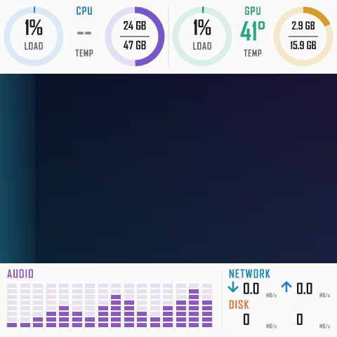

# LoopPanel

[简体中文](README.md) | [English](README.en.md) | **한국어**


LoopPanel은 Windows용 경량 네이티브 USB 화면 표시 프로그램입니다. 로컬 이미지, GIF 또는 내장 애니메이션 효과를 편집 가능한 MiniJinja + SVG 템플릿과 결합하고, 로컬 하드웨어 정보를 수집하며 오디오 스펙트럼을 재생한 뒤, 완성된 화면 전체를 지원되는 디스플레이로 직접 전송합니다.

현재 버전에서 검증된 장치 구성은 JONSBO TM-360과 TM-280이 공유하는 480×480 MacroSilicon MS9132 화면 하나뿐입니다. 두 제품은 라디에이터 규격만 다르며, 둘 다 실기에서 검증되었습니다. 프로젝트 이름은 범용적이지만, 전송 계층은 현재 "모든 JONSBO 화면용 범용 드라이버"가 아닙니다. 자세한 내용은 [호환성](#호환성)과 [장치 이식 가이드](docs/DEVICE_PORTING.md)를 참고하십시오.



LoopPanel은 독립적인 커뮤니티 프로젝트이며, JONSBO, MacroSilicon, PawnIO, NVIDIA, AMD와 제휴 관계나 공식 승인 관계가 없습니다.

## 프로젝트 배경

이 프로젝트는 JONSBO TM-360의 공식 상주 소프트웨어를 대체하려는 필요에서 시작되었습니다. 구현 과정에서 실제 장치를 사용하여 USB 디스크립터 대조, 공개 캡처와의 비교, 프레임 형식 검증, 색상 및 방향 테스트, 킵얼라이브 실험, 리소스 측정, 장시간 동적 표시 테스트를 수행했습니다.

디스플레이 프로토콜은 [Fakinvisibility/b360gt-driver](https://github.com/Fakinvisibility/b360gt-driver/tree/94ae7f2a710123b582ca3fa806d85ee1c684e287)의 B360GT Windows USBPcap 실기 캡처를 주된 근거로 합니다. 시작 시퀀스, UYVY422 인코딩, 프레임 분할은 이 컴퓨터의 TM-360에서 실제로 통과했습니다. DS339에 대한 후속 실기 수정 사항도 초기의 잘못된 BGR888 결론을 배제하는 데 사용되었습니다: [UYVY 수정](https://github.com/emaspa/InfoPanel-linux/commit/21fe373f8de962491169d0d611fb297321df60ec), [초기화 타이밍 수정](https://github.com/emaspa/InfoPanel-linux/commit/94415ac46260cf5f1b0d4e670b9a48e4ad38105b).

저장소는 MIT License를 따릅니다. 서드파티 구성 요소와 PawnIO IntelMSR, AMDFamily17 모듈의 라이선스는 [THIRD-PARTY-NOTICES.md](THIRD-PARTY-NOTICES.md)와 [THIRD-PARTY-LICENSES.txt](THIRD-PARTY-LICENSES.txt)를 참고하십시오.

## 주요 기능

- `LoopPanel.exe` 하나를 더블클릭하면 화면 표시와 네이티브 Win32 트레이가 시작됩니다.
- CPU 온도 서비스가 없는 최초 실행 시 UAC 창이 한 번 표시되며, 설치에 성공하면 이후 실행에서는 권한 상승을 요구하지 않습니다.
- 트레이에서 로그인 시 자동 시작 설정, 설정 파일 열기, 상태 확인, 안전한 종료를 할 수 있습니다.
- 직접 제작한 16:9 샘플 배경 3종, PNG, JPEG, GIF, 그리고 소재가 없을 때 사용하는 내장 애니메이션 효과를 제공합니다.
- 480×270 크기의 16:9 중앙 이미지 영역과, 자유롭게 편집할 수 있는 480×480 SVG 계기판 레이어를 제공합니다.
- CPU, RAM, NVIDIA 또는 AMD Radeon GPU, VRAM, 네트워크, 디스크 정보를 표시합니다.
- WASAPI 루프백 캡처, 1024포인트 FFT, 16밴드 실시간 오디오 스펙트럼을 지원합니다.
- 트레이 메뉴에서 표시 방식(기본 대시보드, 또는 CPU 온도와 사용률만 크게 보여주는 단순 화면)과 온도 단위(섭씨 / 화씨)를 바꿀 수 있습니다.
- 트레이 문구와 메시지는 Windows 표시 언어를 따릅니다: 중국어 간체, 영어, 한국어.
- 단일 인스턴스 화면 잠금과 공식 소프트웨어 충돌 검사를 수행합니다.

이 프로그램에는 브라우저 엔진, 웹 서비스, 계정, 텔레메트리, 자동 업데이트, ARGB 제어 코드가 없습니다.

## 호환성

현재 지원되며 실기 검증을 마친 장치 구성은 다음 하나뿐입니다.

| 항목 | 현재 구성 |
|---|---|
| 실측 제품 | JONSBO TM-360, TM-280(동일한 화면 모듈, 라디에이터 규격만 다름. Ryzen 7 7800X3D + Radeon RX 9070 XT 시스템에서 실기 검증) |
| USB VID/PID | `345F:9132` |
| 컨트롤러 계열 | MacroSilicon MS9132 |
| 해상도 | 480×480 |
| 디스플레이 모드 | VIC 143, UYVY422 |
| 제어 인터페이스 | HID interface 0, 9바이트 Feature Report 버퍼 |
| 비디오 인터페이스 | vendor interface 3, bulk OUT endpoint `0x04` |
| 프레임 크기 | 460,816바이트 |
| 분할 | `7 × 65,536 + 2,064`, 프레임 뒤에 ZLP 없음 |
| Windows 드라이버 | `HidUsb` + `libusb0`, 보통 `MS USB Display`로 표시됨 |

센서 수집과 화면 전송 계층은 서로 독립적이며, 로컬 하드웨어에 따라 자동으로 선택됩니다.

| 하드웨어 | 데이터 출처 | 설명 |
|---|---|---|
| Intel CPU | PawnIO `IntelMSR` | Package 온도 |
| AMD CPU, Family 17h–1Ah(Zen~Zen 5) | PawnIO `AMDFamily17` | SMN이 보고하는 온도 Tctl. 일부 Zen/Zen+ 모델은 Linux k10temp의 오프셋 표에 따라 Tdie로 환산 |
| NVIDIA GPU | 드라이버 내장 NVML | 우선 사용 |
| AMD Radeon GPU | 드라이버 내장 ADL(`atiadlxx.dll`) | NVML을 사용할 수 없을 때 사용. 드라이버가 `ADL2_New_QueryPMLogData_Get`을 지원해야 하며, AMD 어댑터가 여러 개일 때는 전용 VRAM이 가장 큰 것을 선택 |

그 밖의 CPU(더 오래된 AMD 계열 포함)는 온도를 지원하지 않으며, 온도 서비스 설치 자체 점검이 실패하고 명확한 오류가 표시됩니다.

브랜드, 컨트롤러 또는 `345F:9132` VID/PID가 같다는 것만으로는 호환 여부를 판단할 수 없습니다. 같은 컨트롤러 계열 안에서도 해상도, 프레임 헤더 상위 비트, ZLP, 트리거, 초기화 전략이 서로 다른 사례가 확인되었습니다. 현재 코드는 다른 JONSBO 디스플레이 탑재 수랭 쿨러나 다른 MS9132 OEM 화면을 지원 장치로 잘못 표시하지 않습니다.

## 사용 방법

### 사전 조건

1. Windows 10/11 x64
2. TM-360에 원래 설치되어 있던 서명된 `MS USB Display` / `libusb0` 드라이버
3. PawnIO 2.x가 설치되어 있어야 합니다. 해당 드라이버와 `PawnIOLib.dll`은 이 프로젝트와 함께 배포되지 않습니다.
4. 이 화면을 구동 중인 제조사 프로그램 `JONSBO-AIO.exe` 또는 `LcdFusion.exe`(LCD Fusion)를 완전히 종료해야 합니다.

### 실행

배포 디렉터리 안의 파일 상대 위치를 바꾸지 않은 상태에서 다음 파일을 더블클릭합니다.

```text
LoopPanel.exe
```

인수, 명령줄, 시작 스크립트는 필요하지 않습니다.

최초 실행 시 시스템에 LoopPanel CPU 온도 서비스가 아직 없으면 메인 프로그램이 UAC를 한 번 요청합니다. 권한이 상승된 내부 서비스 프로그램이 PawnIO를 확인하고, 최소 온도 서비스를 설치하여 시작한 다음, 제어권을 일반 권한의 LoopPanel 메인 프로그램에 돌려줍니다. 설치에 성공한 뒤에는 수동 실행과 로그인 자동 시작 모두 UAC가 다시 표시되지 않습니다.

사용자가 UAC를 취소하거나 온도 서비스 설치/자체 점검이 실패하면, LoopPanel은 오류를 표시하고 이번 시작을 중단합니다. 기본 온도 기능이 없는 상태로 화면 출력을 계속하지 않습니다.

실행 후 트레이 아이콘을 우클릭하면 다음을 할 수 있습니다.

- 화면 및 CPU 온도 상태 확인
- `looppanel.toml` 열기
- "표시"에서 기본 / 단순 화면 전환, "단위"에서 섭씨 / 화씨 전환. 선택은 즉시 적용되고 저장됩니다.
- "로그인 시 자동 시작" 켜기 또는 끄기
- 연결 실패 후 재시도
- 종료 및 USB 인터페이스 해제

## 설정

프로그램은 항상 `LoopPanel.exe` 옆의 `looppanel.toml`을 읽습니다. 배경, 템플릿, 글꼴의 상대 경로는 모두 이 설정 파일이 있는 디렉터리를 기준으로 합니다.

```toml
background = "samples/aurora-circuit.jpg"
template = "dashboard.svg.jinja"
font = 'C:\Windows\Fonts\bahnschrift.ttf'
title = "LoopPanel"
custom_lines = []

fps = 5
sensor_interval_ms = 1000
brightness = 0.90
show_clock = false
show_sensors = true
```

- `background`: PNG, JPEG 또는 GIF입니다. 기본값은 패키지에 포함된 `aurora-circuit.jpg`이며, `liquid-alloy.jpg` 또는 `orbital-glass.jpg`로 바로 전환할 수도 있습니다. 생략하면 내장 애니메이션 효과를 사용합니다.
- `template`: MiniJinja SVG 템플릿입니다.
- `font`: 이 로컬 TTF/TTC 글꼴 하나만 불러옵니다.
- `fps`: 1–30이며, 내장 애니메이션 효과와 GIF의 프레임 레이트 상한으로 사용됩니다.
- `sensor_interval_ms`: 최소 250 ms입니다. 기본 템플릿은 하드웨어 데이터를 1 Hz로 갱신합니다.
- `brightness`: 0.05–1.0입니다.
- `show_clock`, `show_sensors`: 템플릿이 판단에 사용하는 값이며, 해당 샘플링과 갱신도 제어합니다.

배경은 비율을 유지한 채 중앙의 480×270 영역에 맞춰 배치되며, 기본 템플릿은 위아래 영역에 정보를 그립니다. GIF는 최대 120프레임이며 시작 시 디코딩하여 상주 메모리를 억제합니다. JONSBO 공식 소재는 이 저장소에 포함되어 있지 않습니다.

설정이나 템플릿을 수정한 후에는 트레이에서 종료하고 `LoopPanel.exe`를 다시 더블클릭하여 새 내용을 불러옵니다.

## 템플릿 문법

템플릿은 유효한 480×480 SVG를 생성해야 합니다. LoopPanel은 엄격한 미정의 변수 검사와 XML 자동 이스케이프를 사용합니다. 필드 이름을 잘못 입력하면 빈 내용을 조용히 출력하지 않고 즉시 오류가 발생합니다.

```xml
<svg xmlns="http://www.w3.org/2000/svg" width="480" height="480" viewBox="0 0 480 480">
  
  <text x="20" y="30">{{ "%.0f"|format(cpu.load_percent) }}%</text>
  
  
  <text x="20" y="60">{{ "%d"|format(gpu.temperature_c) }}°C</text>
  
  <g id="audio-spectrum"/>
</svg>
```

템플릿에서는 조건문, 반복문, 포맷 필터를 사용할 수 있습니다. 하드웨어 값이 없으면 `none`입니다. 정확한 컨텍스트 구조, 필드, 예제, 오디오 스펙트럼 마커 규칙은 [템플릿 가이드](docs/TEMPLATES.md)를 참고하십시오. 기본 템플릿은 편집 가능한 예제일 뿐이며 프로그램에 고정된 레이아웃이 아닙니다.

## 기술 스택

- Rust 2024 edition. 실측 툴체인은 Rust 1.97.1
- `x86_64-pc-windows-gnullvm`, `rust-lld`, `+crt-static`, Thin LTO
- Win32, SetupAPI, HID Feature Report, `libusb0` bulk OUT
- MiniJinja 2.21 + resvg/usvg/tiny-skia
- `image`로 PNG, JPEG, GIF 디코딩
- PDH Processor Utility, Windows CPU Set, NT per-core busy times, PowrProf, GlobalMemoryStatusEx
- NVIDIA 드라이버 내장 NVML 또는 AMD 드라이버 내장 ADL
- IP Helper API, PDH
- WASAPI loopback + 자체 구현 radix-2 FFT
- PawnIO 2.x + 공식 IntelMSR 모듈(Intel Package 온도) 또는 AMDFamily17 모듈(AMD Tctl/Tdie 온도)

자세한 데이터 흐름과 모듈별 역할은 [아키텍처 설명](docs/ARCHITECTURE.md)을 참고하십시오.

## 빌드

프로젝트의 기본 타깃은 `.cargo/config.toml`에서 `x86_64-pc-windows-gnullvm`으로 설정되어 있습니다.

```powershell
cargo fmt --all -- --check
cargo test --all-targets --locked
cargo clippy --all-targets --locked -- -D warnings
cargo build --release --bins --locked
```

생성되는 프로그램은 다음 두 개뿐입니다.

- `looppanel.exe`: 콘솔 창이 없는 GUI 메인 프로그램이며, 배포 시 `LoopPanel.exe`라는 이름을 사용합니다.
- `looppanel-temperature-service.exe`: 메인 프로그램이 최초 실행 시 내부적으로 호출하는 서비스 프로그램이며, 사용자가 직접 실행하는 진입점이 아닙니다.

빌드 디렉터리에는 `dashboard.svg.jinja`도 함께 생성되며, `looppanel.toml`에서 다른 템플릿 경로를 지정하지 않는 한 `LoopPanel.exe`와 같은 디렉터리에 있어야 합니다.

아이콘의 벡터 원본 파일은 `assets/looppanel-icon.svg`에 있습니다. 같은 디렉터리의 투명 PNG와 다중 크기 ICO는 배포용 파생 리소스입니다. 메인 프로그램은 ICO를 트레이 아이콘으로 직접 내장합니다.

## 안전 경계

- 메인 프로그램을 더블클릭하면 지원되는 USB 화면에 접근할 수 있습니다. 코드를 테스트하거나 검토할 때 프로그램 실행을 읽기 전용 점검으로 간주하지 마십시오.
- JONSBO-AIO 또는 LCD Fusion이 실행 중이거나 다른 LoopPanel 인스턴스가 이미 있는 것을 발견하면 화면 쓰기를 거부합니다.
- HID, SetupAPI, `libusb0.dll`, `nvml.dll`, `atiadlxx.dll`은 Windows 시스템 디렉터리에서만 불러옵니다.
- 디스플레이 경로에는 펌웨어, EEPROM, USB 디스크립터 또는 알 수 없는 명령을 쓰는 기능이 없습니다.
- CPU 온도 서비스는 고정된 샘플링 요청만 받으며, 임의의 MSR/SMN 주소나 쓰기 작업은 받지 않습니다. AMD 경로에서는 공식 모듈이 SMN 인덱스 레지스터에 고정된 온도 레지스터 주소를 쓴 뒤 데이터를 읽으며, 그동안 `Global\Access_PCI` 뮤텍스를 점유합니다.
- 현재 바이너리는 아직 Authenticode 서명이 되어 있지 않으므로, 공개 배포 전에 코드 서명과 Windows 버전 리소스를 완료해야 합니다.

## 다른 화면 지원 추가

해상도를 바꾸거나 VID/PID를 재사용하는 방식으로 호환성을 추측하지 마십시오. 새로운 화면마다 디스크립터, 공식 소프트웨어 시작 캡처, 프레임 구조, 색상 방향, 분할/트리거, 킵얼라이브에 대한 실측이 필요합니다. 전체 절차, 코드 반영 위치, 검수 체크리스트는 [장치 이식 가이드](docs/DEVICE_PORTING.md)를 참고하십시오.
